# MTS Pi — Apple CarPlay on the Ducati Multistrada V4 S dashboard

Apple CarPlay on the **original 6.5" dashboard** of the Ducati Multistrada V4 S, using a **Raspberry Pi 3 A+** and a
**Carlinkit CPC200-CCPA** dongle: about 110 € of parts at late-2026 prices, plus a microSD card and a short USB
cable. Nothing on the bike is modified and nothing is installed on the iPhone. The Pi sits in the tank
compartment, powered by the USB socket there. It connects to the dashboard the way a phone running the Ducati
Connect app does, and to the iPhone it looks like a car with wireless CarPlay.

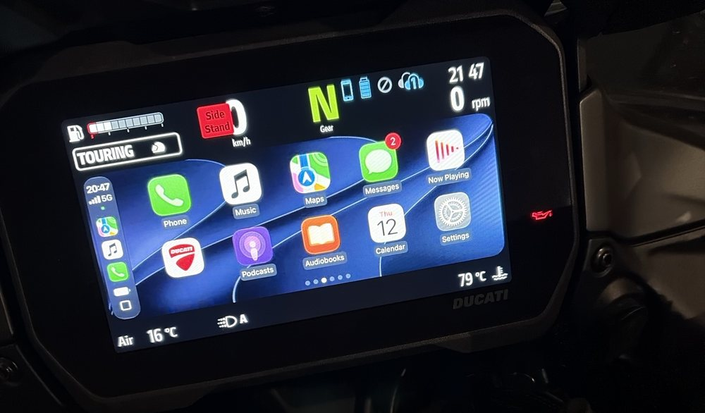

*CarPlay on the bike's own dashboard, 16 Nov 2026. The first icon in the second row is the button that leads
back to the Pi's home screen. The picture on it is the one we chose for our own dongle: MTS Pi ships none, and
without one the button is a plain red square with the letter M.*

| | |
|---|---|
| 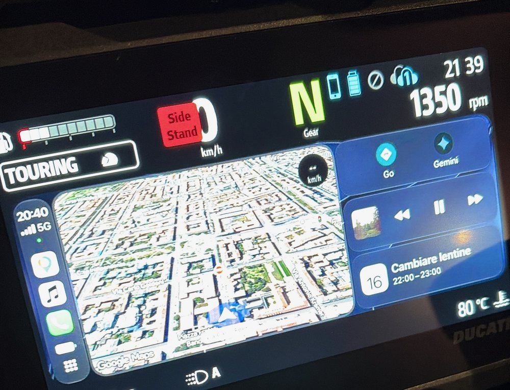 | 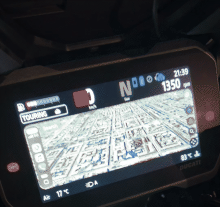 |

*Left: CarPlay's own dashboard view, engine running. Right: from the map to the apps with the joystick, filmed on
the bike (14 s, no sound).*

What you get on the bike:

- **CarPlay on the dashboard**, drawn at the dashboard's own size and driven with the handlebar joystick: Maps,
  Waze, Google Maps, music, podcasts;
- **music and navigation voice in the helmet**, through the bike's own Bluetooth link to the intercom;
- **phone calls**: ring with the caller's name, answer and hang up from the bike or the helmet button, voice
  both ways;
- the bike's own **Music** and **Phone** menus keep working: track title and play/pause/skip, recent calls with
  their names;
- a small **home screen** of the Pi inside Ducati Connect: start and stop CarPlay, see what is connected, settings.

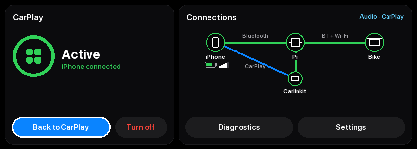

*The Pi's home screen, drawn by the code at 848×304: the area the dashboard gives to Ducati Connect.*

> **Status: beta, tried on the bike.** On 16 Nov 2026, on a Multistrada V4 S with the ready-made card: pairing
> from scratch, CarPlay on the dashboard while riding, joystick, music with the titles in the bike's menu, recent
> calls with their names in the bike's Phone menu, a call placed from CarPlay and closed from the bike, power from the USB socket in the tank compartment. Still open
> after that evening: once the dashboard dropped off the air for half a minute and CarPlay came back only after
> key off and on (the part that was our fault is fixed, not yet tried on the bike again); incoming calls have
> been tried on the bench only.
> On 21 Nov 2026, a second ride, with the card protected against power cuts: about ten key-offs and key-ons without
> a problem, the iPhone's real battery and signal in the bike's status bar, the bike's Wi-Fi joined in 2–5 s,
> calls, and Siri from the helmet once the Pi showed it to the bike as a call. The same ride found three faults
> that needed the key or the Pi's plug: twice the Pi's radio chip gave way with many things going on at once, and
> once the bike's Wi-Fi gave no address and the Pi did not try again. The current image tries again and restarts
> the radio, or itself, when that happens (see [Known limits](#known-limits)): that part has been tried on the
> bench only.
> On 22 and 23 Nov 2026 the bench found what made the radio chip give way: an open voice link (a call, or Siri) on
> the serial port the chip normally uses. With Bluetooth moved to the Pi's other serial port the fault did not come
> back in 4,165 openings of the voice link, over one night and a morning (14 hours) with a real map on the screen,
> music and the phonebook downloading. Not yet tried on the bike.
> `install.sh` on a blank system has not been run on a real Pi yet. This page is updated as things are tried.

> **Unofficial project, at your own risk.** MTS Pi is a hobby project, not a product. It is not affiliated with,
> endorsed by or supported by Ducati, Apple, Bosch, Carlinkit or Raspberry Pi. Set things up with the bike standing
> still, and ride with your eyes on the road: you are responsible for riding safely and for the traffic laws that
> apply to you.

## How it works

The dashboard talks to **one phone at a time**. Normally that phone is your iPhone: calls and music reach the
helmet through the bike, but the screen stays Ducati's (or shows the Ducati Connect app, which has its own
navigation and nothing else).


With MTS Pi, **the bike's phone is the Pi**. The iPhone is disconnected from the bike (the pairing can stay) and
talks to the Pi in two ways: CarPlay through the Carlinkit, and a plain Bluetooth link for data.


The devices sit in the same place in both pictures; only the arrows change.

| Path | Route |
|---|---|
| **Screen** | CarPlay video (H.264) → Carlinkit → USB → Pi: decoded, redrawn at 848×304, sent as JPEG frames over Wi-Fi to the dashboard. The joystick comes back the same way and becomes CarPlay key presses. |
| **Music** | CarPlay audio → USB → Pi → Bluetooth (A2DP) → dashboard → helmets. CarPlay's own sounds (navigation voice, alerts) are mixed into it. |
| **Calls** | CarPlay call audio → USB → Pi → Bluetooth (HFP) → dashboard → helmet, and the helmet microphone goes the other way to the iPhone. |
| **Bike data** | Bluetooth between Pi and dashboard: the control channel of the screen link, track title and buttons of the Music menu (AVRCP), phonebook and recent calls (PBAP). |
| **iPhone data** | Bluetooth between iPhone and Pi: battery, signal and the caller's number (HFP), phonebook (PBAP). No sound travels here: the Pi deliberately does not offer itself to the iPhone as a headset, so calls and music always stay on CarPlay. |

Two things make this possible on such a small board:

- The dashboard tells the phone how big its picture is (848×304 on the V4 S), and CarPlay is asked for exactly
  that size. Nothing is scaled, and there are no black bands.
- The Pi 3 A+ has one radio chip for Wi-Fi and Bluetooth, like a phone. It carries the Wi-Fi link to the dashboard
  and two Bluetooth links at once, to the dashboard and to the iPhone, each with several services on it (the
  helmets stay connected to the bike, as always). Most of the work in this project went into keeping that radio
  happy: see [Things we learned](#things-we-learned).

## Hardware

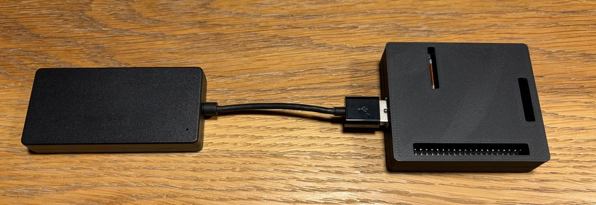

*All of it: the Carlinkit dongle (left) plugged into the Raspberry Pi 3 A+ in its printed case (right). The case
is about 7 cm wide.*

| Part | Notes |
|---|---|
| Raspberry Pi **3 Model A+** | The only board tested. Small, low power, hardware H.264 decoding, 2.4/5 GHz Wi-Fi and Bluetooth on one chip. Add a small heatsink. |
| Carlinkit **CPC200-CCPA** | The "wireless CarPlay for Android head units" dongle (it shows up as *AutoKit*). **Not** the "wired to wireless" adapters such as the 2air: those need a car that already has CarPlay. There is nothing to check before buying: any CPC200-CCPA should do, with the firmware it comes with (the code accepts both USB IDs these dongles use, 1314:1520 and 1314:1521). We have tried one unit; for reference, ours reports 1314:1520 and firmware 2025.10.15. Once yours works, do not update its firmware. |
| microSD card | 8 GB is enough for space (the installed system takes about 3 GB). In practice: a 32 GB **Class 10** card (A1 if you can), from about 13 € for a budget brand to about 23 € for SanDisk or Samsung at late-2026 prices. Our bench tests ran on a SanDisk Ultra 32 GB (Class 10, A1), the evening on the bike on a SanDisk Extreme 64 GB. Avoid old Class 4 cards: we tried one, writing the image took about 20 minutes instead of 3. A "high endurance" card is not needed: the Pi writes very little. |
| Case | Optional. We printed this one: [Ultra-slim snap-fit case for Raspberry Pi 3 A+](https://makerworld.com/en/models/2547063-ultra-slim-snap-fit-case-for-raspberry-pi-3a-plus) on MakerWorld; with it the Pi fits in the tank compartment (photo in [Our build](#our-build)). No 3D printer: the official Raspberry Pi 3 A+ case (red and white, about 5 € from Raspberry Pi resellers, often three times that on Amazon) is the simple choice; we have not measured temperatures inside it. Plastic is the safe choice: a closed metal case can weaken Wi-Fi and Bluetooth, which all go through the antenna on the board, and we have not tested one. Skip cases with a fan: a small 5 V fan is rated 0.1–0.2 A, which on top of our 0.89 A peak is too much for a 1 A socket. |
| Ventilated tank compartment | Strongly recommended, above all for summer: see [Known limits](#known-limits). Standard, as far as we know, from model year 2023; a dealer can fit it to earlier bikes. Ours is the one without the fan, and everything measured here was measured in it. |
| 5 V power | On the bike: the **USB socket in the tank compartment**, which gives 1 A at most. That is where we tested it: no under-voltage through engine start, a ride, music and a call. On the bench the Pi with the dongle drew **0.54–0.89 A at 5 V**, so the margin on that socket is small: nothing else should share it. At home, a supply of 2 A or more. A weak supply or a poor cable causes under-voltage and random faults. |
| Power cable | **USB-A to micro-USB**: the Pi 3 A+ is powered through its micro-USB port. Keep it short, 15–30 cm: there is little room in the tank compartment, and long thin cables lose voltage. A micro-USB plug **angled at 90°** sits better there than a straight one; for example [this 30 cm one](https://www.amazon.it/dp/B0B6YWZ42J) (an example of the kind, not a cable we have tried: check which way the plug points before you buy). |
| iPhone | Any iPhone with CarPlay. |

The Carlinkit plugs into the Pi's only USB port, the power cable into its micro-USB port. That is all the wiring
there is.

| | | |
|---|---|---|
| 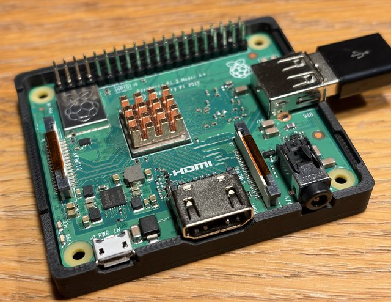 | 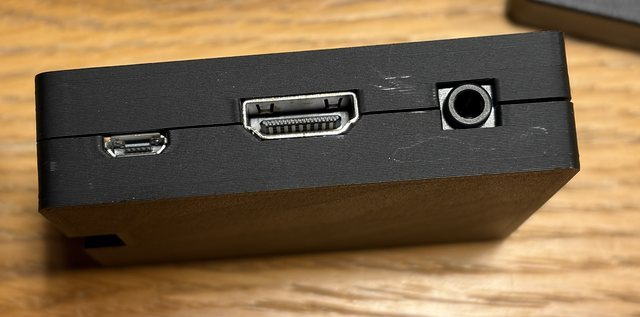 | 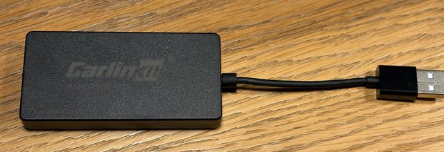 |

*Left: the Pi 3 A+ in the bottom half of the case, with the small copper heatsink on the processor and the
dongle's plug in the USB port. Centre: the side with the power input, the small micro-USB port on the left (HDMI
and audio are not used). Right: the dongle.*

## Install

There are two ways. Both end with the same system on the card.

### The easy way: a ready-made card, no commands

You need a computer with an SD card reader (or a USB adapter for microSD cards).

1. **Download the card image**: the file `mts-pi-….img.xz` from the
   [Releases page](https://github.com/nostoi-labs/mts-pi/releases) of this repository.
2. **Install [Raspberry Pi Imager](https://www.raspberrypi.com/software/)**, the free program that writes cards
   (Windows, macOS, Linux).
3. **Write the card.** In Raspberry Pi Imager choose the device (*Raspberry Pi 3*), then as operating system
   scroll to the bottom, pick **Use custom** and select the file you downloaded, then choose your microSD card
   and write it. Look at the size when you choose the card: every external disk of the computer is in that list,
   and the one you pick is erased. With a custom file the program skips its Customisation step; an older version
   may ask whether to apply customisation settings: answer **No**, nothing needs to be set. Writing takes a few
   minutes with a Class 10 card.

   **The progress counter goes past 100 %** (we saw 110 % every time): the program underestimates the size of the
   file. Nothing is wrong: do not stop it and do not pull the card out. Wait until it has verified the card and
   says you can remove it.

   | | | |
   |---|---|---|
   | 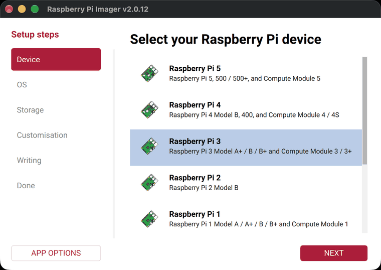 | 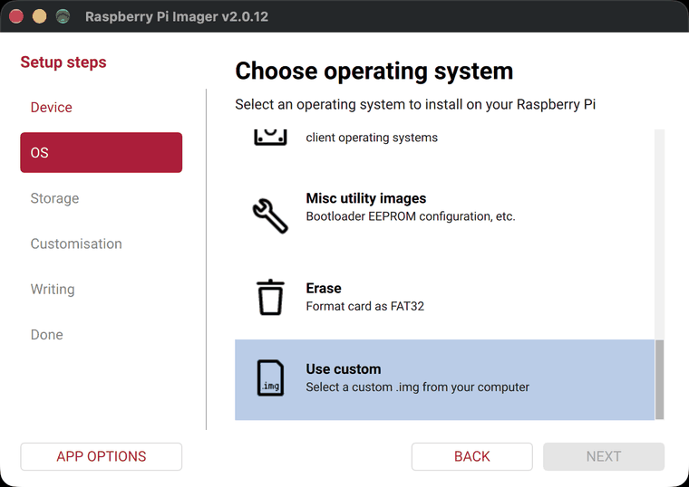 | 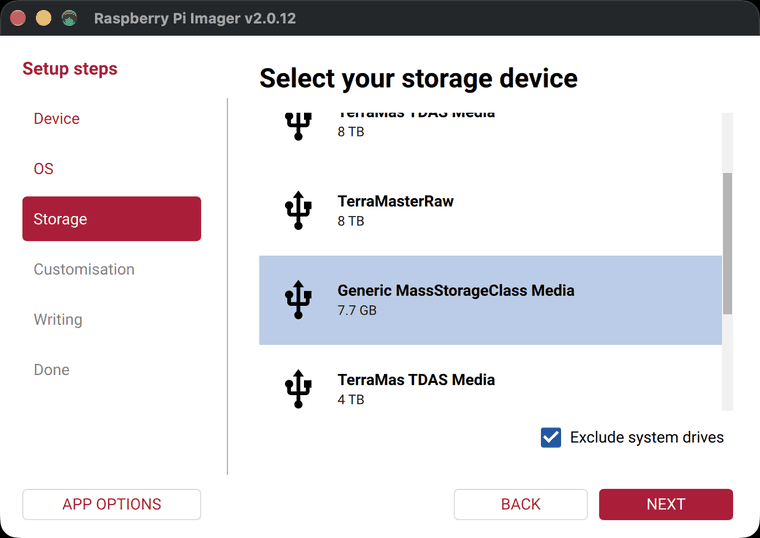 |
   | 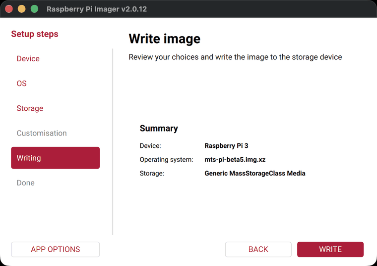 | 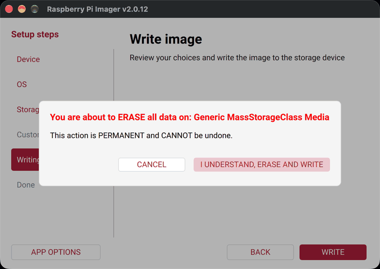 | 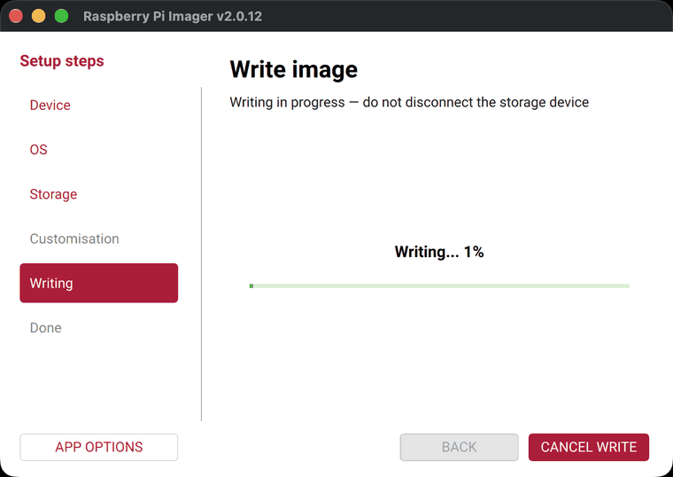 |
   | 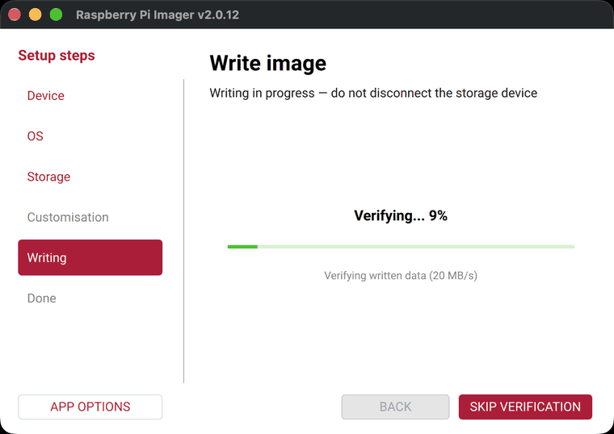 | 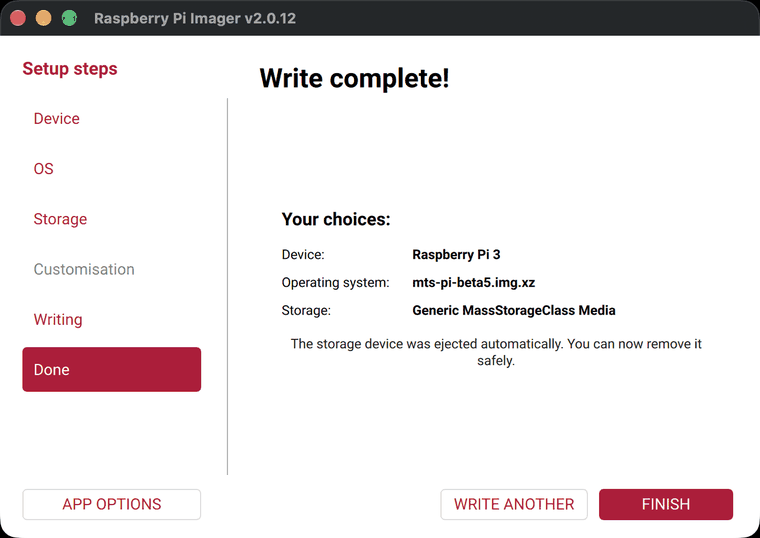 | |

   *Raspberry Pi Imager 2.0 on a Mac, writing the image to an old 8 GB Class 4 card: about 17 minutes of writing,
   then the verification and the final message (last two pictures).*
4. **Start the Pi.** Put the card in the Pi, plug the Carlinkit into its USB port and power the Pi through its
   micro-USB port (at home from a 2 A supply, on the bike from the socket in the tank compartment). The first start
   takes two to three minutes (about two on a fast card, three on an old Class 4 one): the Pi finishes setting
   itself up, then restarts once
   by itself and comes back with the card protected (see below). Leave it alone until then: if the iPhone already
   knows the dongle, CarPlay connects for a moment during that first start, drops at the restart and comes back
   to stay. When **MTS Pi**
   shows up among the Bluetooth devices on your iPhone and stays there, it is ready: go on with
   [Pairing](#pairing). The light on the Carlinkit stays red until CarPlay connects.

That is all. The Pi does not need your home Wi-Fi, a keyboard or a screen. To update, write a newer image the same
way and pair again.

**The card is protected against power cuts.** The bike cuts the power to the Pi at every key-off, without
warning. On the ready-made card nothing is written while the Pi works: the system is read-only, pairings,
phonebook and settings sit on a small partition of their own that is written only when one of them changes, and
the logs stay in memory. On our bench the Pi lost power 300 times in a row and came back every time with
everything in place; it also did when the power went ten seconds after pairing an iPhone, in the middle of saving
the phonebook, and with CarPlay in use. If you want to change the system yourself (an update, an experiment),
write `PROTECT=off` in `mtspi.txt`: the Pi restarts once and stays writable until you write `PROTECT=on` or delete
the word. A manual installation is not protected.

**Optional: your country, home Wi-Fi and remote access.** After writing the card, take it out and put it back
in: your computer shows a small drive called `bootfs`. On it there is a text file, `mtspi.txt`. Open it with any
text editor and fill in what you want: the two-letter code of your country (recommended), the name and password
of your home Wi-Fi, and an SSH public key if you want to log in to the Pi from your computer
(`ssh mtspi@mts-pi.local`). The Pi applies the file at every start and removes the Wi-Fi password from it once it
has been used. With a home Wi-Fi set, and no bike around, the Pi joins it about a minute and a half after
power-on. The same file has a line that switches Siri off, `SIRI=off` (see
[Known limits](#known-limits)), the `PROTECT=` line described above, and `LOGS=card`, which keeps the logs on the
card instead of in memory. Leave the file as it is if none of this means anything to you.

**Updating without writing the card again.** A card that already runs a version with this feature takes the next
ones from a file. Download `mts-pi-update-….tar.gz` from the [Releases page](https://github.com/nostoi-labs/mts-pi/releases),
copy it as it is (do not unpack it) onto the `bootfs` drive of the card, next to `mtspi.txt`, put the card back and
power the Pi. It checks the file, installs the new version next to the old one, switches to it, restarts once and
writes what happened in `mts-pi-update-result.txt` on the same drive. Pairings and settings stay as they are. If the
file is damaged, or the new version does not start on your card, nothing changes and the result file says why. To go
back to the version before, put a file named `mts-pi-rollback.txt` (empty is fine) on the same drive and power the
Pi. The power can go at any moment of all this: the card holds either the old program or the new one, never half of
each. Only the program is updated, not the operating system: when a version needs a new card image, the update says
so and is not installed. *(Tried on a real protected card on 23 Nov 2026: update, way back, a package for a newer
image and a damaged one both refused, and eleven power cuts at different moments of an update, each of which the Pi
finished by itself at the next start. Not yet done by anybody but us.)*

> The ready-made image is built automatically from this repository by
> [`image/build.sh`](image/build.sh): it is the official Raspberry Pi OS Lite with MTS Pi installed by the same
> `install.sh` described below.

### The manual way: for people who want to look inside

This path has not been run from start to finish on a real Pi yet; the ready-made image is built with the same
`install.sh`.

1. Write **Raspberry Pi OS Lite (64-bit)** to the SD card with Raspberry Pi Imager. In the Imager settings choose a
   user name and password, enter your home Wi-Fi **with its country**, and turn SSH on.
2. Put the card in the Pi, plug the Carlinkit in, power the Pi, wait two minutes and connect:
   `ssh <user>@<hostname>.local`
3. On the Pi:

   ```bash
   sudo apt-get update && sudo apt-get install -y git
   git clone https://github.com/nostoi-labs/mts-pi.git
   cd mts-pi
   ./install.sh
   sudo reboot
   ```

The installer sets up Bluetooth, Wi-Fi Direct, the audio services and the MTS Pi services. It does not touch the
boot files and it does not remove pairings. `./install.sh --help` lists the options (another Bluetooth name, a
setup without the Carlinkit). You can run it again at any time, for example after `git pull`.

**Where the Pi is on the network.** At every power-on the Pi first looks for the bike, and its Wi-Fi is busy doing
that. Without the bike it goes back to your home Wi-Fi after about a minute. So after a reboot at home, wait a
minute before you connect with SSH.

## Pairing

Three pairings, once. Steps 2 and 3 need only the Pi and the iPhone and can be done at home; step 1 is done at
the bike, standing still, with the Pi powered.

1. **Bike ↔ Pi.** On the dashboard: Settings › **Bluetooth** › **Pairing** › **Phone**, and pick **MTS Pi**.
   The dashboard shows a pairing code: choose **Accept** (the Pi accepts on its side by itself). A few seconds
   later it says "Paired".

   | | | |
   |---|---|---|
   | 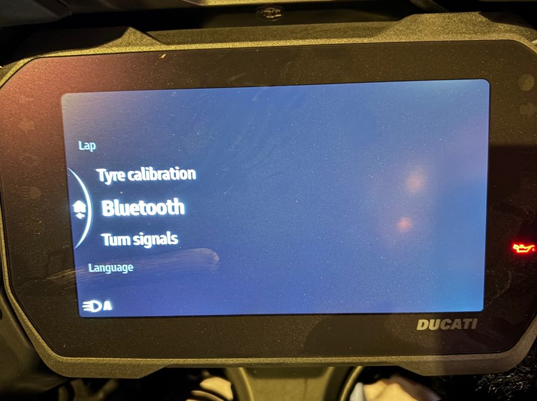 | 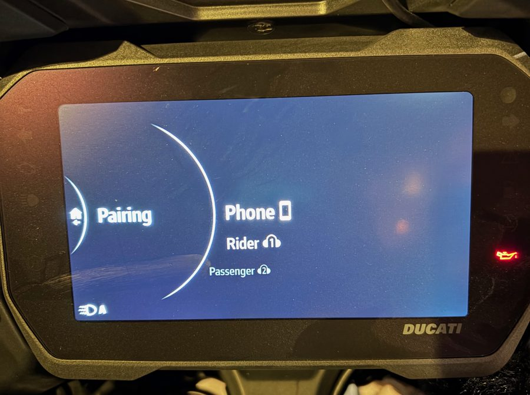 | 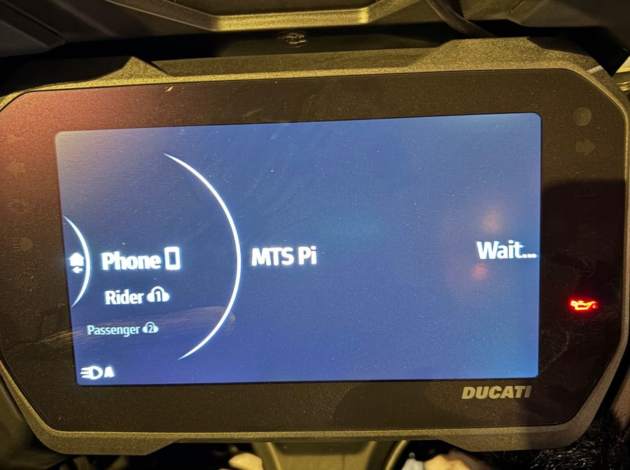 |
   | 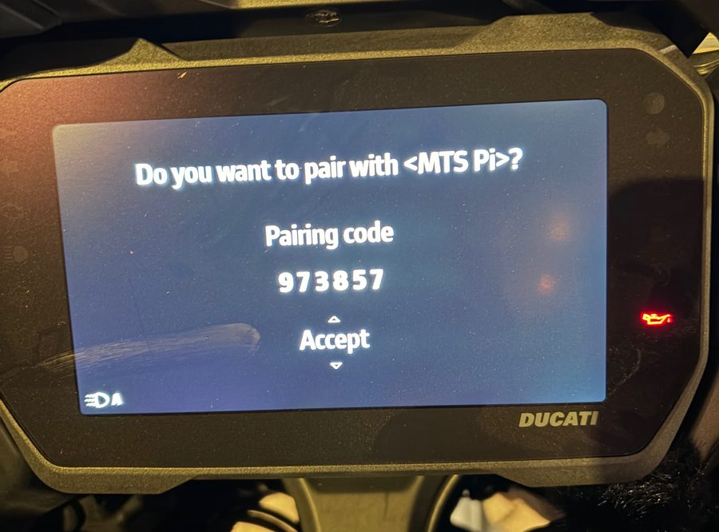 | 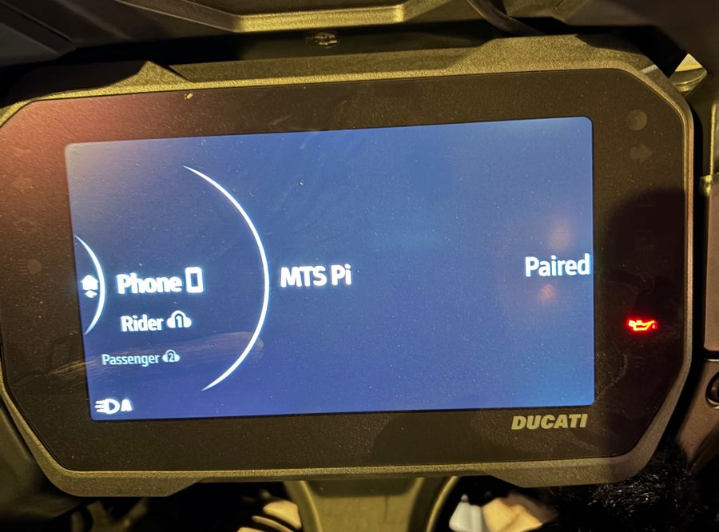 | 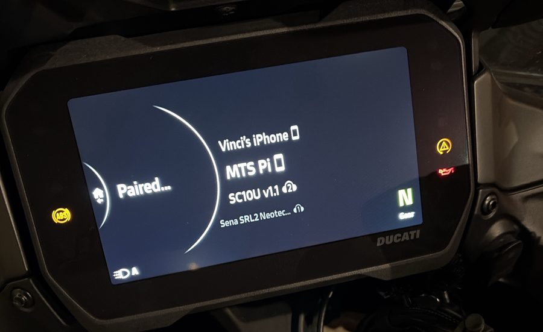 |
2. **iPhone ↔ Pi.** On the iPhone: Settings › Bluetooth › **MTS Pi**, and confirm the code the iPhone shows (the
   Pi accepts by itself). Then tap the **(i)** next to MTS Pi and turn on **Sync Contacts** (leave **All
   Contacts** ticked) and **Show Message Notifications** (on some iOS versions it reads *Show Notifications*):
   the bike's Phone menu and the caller's name use them. The two switches appear a few seconds after pairing;
   the phonebook reaches the Pi within a few minutes.

   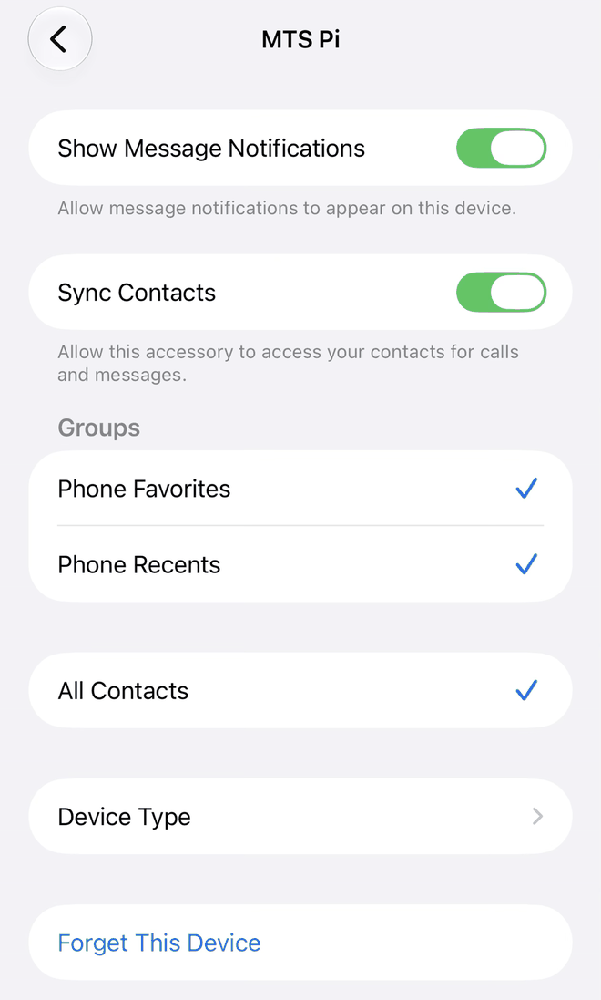

   *The page behind the (i) next to MTS Pi on the iPhone, with both switches on.*
3. **iPhone ↔ Carlinkit.** In the same list pick the dongle (its name starts with **AutoKit**) and accept
   "Use CarPlay". It takes about ten seconds, once; after that CarPlay connects by itself, about ten seconds
   after the Pi has started.

With the three pairings done, whatever plays in CarPlay comes out of the helmet, and **Ducati Connect** on the
dashboard becomes selectable.

If your iPhone was paired with the bike directly, **disconnect** it there (no need to delete the pairing): the
bike keeps one phone at a time, and now that phone is the Pi. As long as the iPhone stays in the bike's list, the
bike may connect to it again at key-on instead of the Pi; when that happens Ducati Connect has no CarPlay, and
disconnecting the iPhone in the bike's Bluetooth menu brings it back.

## Using it

1. Turn the key. The Pi boots with the bike and connects by itself: Ducati Connect was ready between 53 s and
   100 s after key-on in our tests on the bike.
2. Open **Ducati Connect** on the dashboard: the Pi's home screen appears, and CarPlay starts by itself (you can
   turn that off in the settings).
3. In CarPlay the joystick **up and down** moves the selection one step in that direction; **left and right** go
   to the previous and the next item, like the wheel of a car's controller (in a map application that is how
   you reach the buttons on the map, while up and down move the map); the centre press selects. **Hold the
   joystick up for one second to go back** one level. The red **M** icon among the apps (or your own picture, see
   [Settings](#settings)) brings you back to the Pi's home screen. Holding the joystick left is the bike's own
   way out of Ducati Connect.

   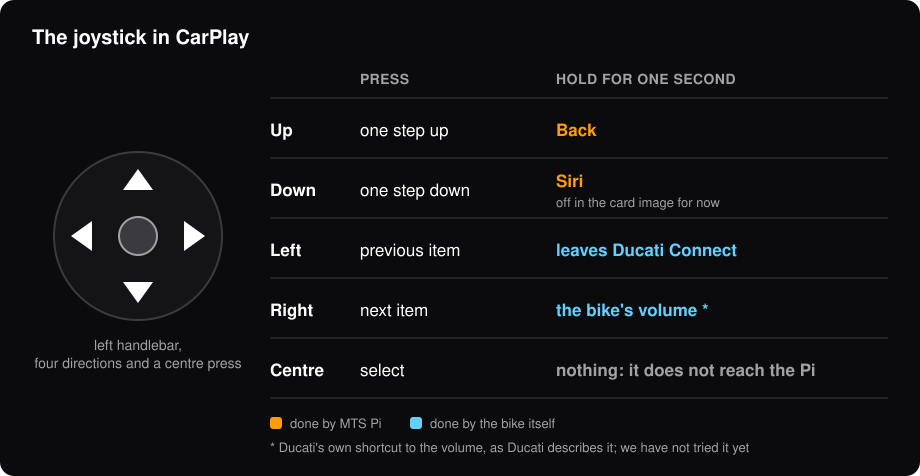
4. Calls ring on the dashboard with the caller's name; answer and hang up from the bike or from the helmet.
5. Leave Ducati Connect whenever you want: music and calls keep going.
6. If the dashboard says "Ducati Connect may have a connection problem" and CarPlay does not come back within a
   minute or two, turn the key off and on.


The settings page, on the dashboard: language (English or Italian), CarPlay at start-up, turning CarPlay off when
you leave Ducati Connect, picture quality (high, or low for slightly more frames), and CarPlay smoothness: 19 pictures a second as it comes, 15 to keep the Pi cooler, or the maximum, 30. The phone delivers fewer than it is asked for, about 16 when asked for 19, and the bike has never taken more than 15 (CarPlay restarts when you change it and leave the page; the music stops for about ten seconds). To leave the page, use its last row or hold the joystick up: in the Pi's own pages that is Back, as
it is in CarPlay.

## What works

| Function | State | How |
|---|---|---|
| CarPlay on the dashboard | **bike** | Carlinkit over USB → H.264 decoded on the Pi → JPEG frames over Wi-Fi |
| Joystick in CarPlay | **bike**; the moves of 17 Nov 2026 on the bench | sent to the dongle as CarPlay's controller: up/down = the knob tilted, left/right = the wheel, centre = select; joystick held up = back |
| Music in the helmet | **bike** | CarPlay audio → A2DP |
| A call placed from CarPlay, closed from the bike | **bike** | the dongle's audio commands → HFP towards the bike, microphone back to CarPlay |
| Incoming calls, answer from the bike or the helmet | bench | the same path; the bike rings through HFP |
| Caller's name | bench | number from the iPhone's HFP link, name from the phonebook kept on the SD card |
| The bike's Music menu | **bike** | track title from the dongle → AVRCP; the bike's buttons → CarPlay play/pause/skip |
| Recent calls with names in the bike's Phone menu | **bike** | PBAP from the iPhone to the Pi, then from the Pi to the bike: the dashboard downloads the phonebook and the call lists. The Multistrada shows the recent calls; it has no screen for browsing contacts. |
| Battery and signal on the home screen | bench | the iPhone's HFP indicators |
| The iPhone's real battery and signal in the bike's status bar | **bike** (21 Nov 2026) | the same indicators passed on to the bike whenever they change; before, the bike showed full bars all the time |
| The Pi's home screen in Ducati Connect, joystick | **bike** | first tried on the Multistrada on 24 Oct 2026 |
| Text messages on the bike | not applicable | the Multistrada's dashboard has no function for messages |
| Siri from the helmet, started by holding the joystick down | **bike** (21 Nov 2026) | the Pi shows Siri to the bike as a call in progress and the bike connects the helmet, about 3 s later, with a tone of its own: speak after the tone. The dashboard shows a call while Siri listens. Dictated messages and voice search in the maps work the same way. The line `SIRI=off` in `mtspi.txt` on the card switches it off |
| Coming back without the key when the bike's Wi-Fi or the Pi's radio fail | bench | a failed join is tried again; if the bike stays silent its Bluetooth link is closed and reopened; then the Wi-Fi Direct program is restarted; as a last resort, or when the Bluetooth radio no longer answers, stays off, or carries a voice link nobody opened, the Pi restarts itself (at most once in 15 minutes). Written after the ride of 21 Nov 2026, not yet seen at work on the bike |

"Bike" means: tried on the Multistrada V4 S on 16 Nov 2026 (or on the date given), with the ready-made card. "Bench" means: real Pi,
real Carlinkit, real iPhone, a helmet intercom playing the part of the bike's Bluetooth, an emulated dashboard
for the screen link, Wi-Fi on 2.4 GHz as on the bike.

## Measured

| What | Value | Where |
|---|---|---|
| Key-on → Ducati Connect ready | about 53 s (Pi boot 28 s + Wi-Fi 16 s) | bike, 24 Oct 2026 |
| Frames the dashboard asks for | 6–13 per second | bike, 24 Oct 2026 |
| CarPlay on the dashboard while riding (map and music) | 11 frames per second (7–13), longest pause 3.2 s | bike, 16 Nov 2026 |
| Key-on → CarPlay ready on the dashboard, ready-made card | about 100 s (Pi boot 29 s, the bike connected at 76 s, Wi-Fi 18 s) | bike, 16 Nov 2026 |
| Music back after a call closed from the bike | 0.5 s | bike, 16 Nov 2026 |
| Address from the bike's Wi-Fi after joining it | 2.3–4.9 s in six joins (6–9 s before); once no address at all | bike, 21 Nov 2026 |
| Helmet microphone open after the bike is told a call has started | about 3.3 s (the same for Siri and for a dictated message) | bike, 21 Nov 2026 |
| Temperature of the Pi after half an hour of CarPlay on the dashboard, 16 °C outside | 56 °C on average at high quality (60 at most); 61 °C at a higher quality that has since been removed, where the Pi starts slowing itself down | bike, 21 Nov 2026 |
| First start of the protected card: power-on → protected and ready | 2–3 min (one restart by itself) | bench, 20 Nov 2026 |
| Power cuts survived by the protected card in one night | 241 of 241 (300 of 300 on the test card the night before) | bench, 21 Nov 2026 |
| An update from a file on a protected card | installed in 10 s, then one restart; 11 power cuts at 11 different moments of it, each finished by the Pi at the next start | bench, 23 Nov 2026 |
| CarPlay asked for 15 pictures a second instead of 30 (map, music, Siri) | the program's work from 141% of one processor to 96%; 59–61 °C instead of 62–65 over two hours | bench, 23 Nov 2026 |
| Each CarPlay frame sent to the dashboard once (the program was sending about 22 pictures a second for 15 frames), Apple Maps and music, three-minute windows one after the other | pictures sent from 22–23 a second to 14–15; the program's work from 79–89% of one processor to 59–69%; data over the radio down by a sixth to a half | bench, 23 Nov 2026 |
| Half an hour of CarPlay with Apple Maps following a route and no music, at 15 pictures a second and then at 30, with that fix; room at 21 °C | at 15: 14 pictures a second sent, 57% of one processor, 53 °C on average (55 at most); at 30: 18 a second (the phone produced no more), 72%, 55 °C (57 at most) | bench, 23 Nov 2026 |
| Changing between 15 and 30 pictures a second from the settings | CarPlay back 4.2–4.4 s after it is opened again, about 9 s without it in all | bench, 23 Nov 2026 |
| CarPlay asked for 15, 19 and 30 pictures a second: a satellite map following a route, with navigation and music; room at 21 °C | pictures that really arrive: 11, 16 and 20 a second; the program's work 69%, 80% and 160% of one processor; the Pi at 56, 58.5 and 60 °C, where it starts slowing itself down | bench, 24 Nov 2026 |
| Two and a half hours of CarPlay at 19 pictures a second, the same map and music, inside four hours of the same program running | 15 pictures a second sent, 81% of one processor, 59.5 °C on average (60.1 at most); the program's memory 128 MB at the start and 124 at the end | bench, 25 Nov 2026 |
| The program restarts while CarPlay is connected | CarPlay back on the dashboard by itself in 20–23 s (the session is closed and opened again), 5 times out of 5 | bench, 25 Nov 2026 |
| Power from the USB socket in the tank compartment (1 A at most) | no under-voltage through engine start and a ride; current on the bike not measured | bike, 16 Nov 2026 |
| Temperature in the tank compartment (the one without the fan), 15 °C outside | 27–41 °C | bike, 16 Nov 2026 |
| CarPlay with a moving map and music | 20–22 frames per second at high quality | bench, 10 Nov 2026 |
| The same during a call | 18–19 frames per second | bench, 10 Nov 2026 |
| Bridge start → CarPlay connected | 4.5–8 s | bench |
| The same on a freshly written card | 8.5–9 s | bench, 16 Nov 2026 |
| First start of a ready-made card: power-on → CarPlay | about 2 min (slow Class 4 card; 1 min 42 s with the image of 18 Nov 2026) | bench, 16 and 18 Nov 2026 |
| The same → home Wi-Fi and remote login | about 2.5 min (2 min 38 s with the current image) | bench, 16 Nov 2026 |
| Later starts of that card: power-on → CarPlay | about 50 s with the leaner system (47–51 s in five starts; 48 and 66 s before). Our program is running after 29–41 s: on a card this slow the same start varies by ten seconds from one time to the next | bench, 18 Nov 2026 |
| Memory the system sees, running services | 462 MB and 18 with the leaner system (415 MB and 21 before) | bench, 18 Nov 2026 |
| Ring with the caller's name | 0.7 s | bench, 10 Nov 2026 |
| Answer from the helmet → voice open | 0.15–0.2 s | bench |
| Music back after a call | 0.6 s | bench, 10 Nov 2026 |
| Current drawn by the Pi with the dongle | 0.54–0.89 A at 5 V | bench |
| Temperature with a copper heatsink | 55 °C | bench |

## Things we learned

Notes for anyone building something similar. Each of these cost an evening or more.

- **One radio, three links.** Wi-Fi to the dashboard is on 2.4 GHz, the same band as the two Bluetooth links, on
  the same chip.
  It holds as long as Bluetooth stays light. What made the difference: idle Bluetooth links go to low-power mode
  after 2 s instead of 45 s; the Pi takes the "central" role on every link, so the radio serves one schedule
  instead of two; and no audio ever comes from the iPhone over Bluetooth.
- **Call audio must be paced by the radio.** Sending one voice packet for each packet received works. Sending
  them on a fixed clock put the Bluetooth chip into a hardware error within seconds.
- **The iPhone picks its audio output by itself.** If the Pi also offers itself as a headset, the iPhone
  sometimes sends the sound there instead of to CarPlay, and CarPlay goes silent. The Pi therefore presents to
  the iPhone only the data profiles.
- **The phone role towards the bike is our own.** The Linux telephony service (oFono) offers the "I am a phone"
  side of hands-free only with a real SIM, so the Pi has its own small hands-free gateway that mirrors the
  iPhone's real state.
- **Without a phonebook service the bike's Phone button stays grey**, and without a music player registered on
  the bike's link the Music menu shows nothing. Both are served by the Pi with data taken from the iPhone.
- **Wi-Fi Direct needs its own `wpa_supplicant`.** NetworkManager adopted the freshly formed group and tore it
  down. While the Pi is in bike mode, NetworkManager does not touch the Wi-Fi interface at all.
- **CarPlay sends video only when the picture changes.** A decoder that waits for the next frame before giving
  you the current one leaves the dashboard several screens behind. The decoder runs without frame threads and
  without a parser delay.
- **The dongle reports calls through audio commands**, not through a call-status message, and it must be told
  that it is not in "HiCar" mode or the iPhone never sees it.
- **A fresh Raspberry Pi OS keeps Wi-Fi off twice.** Unblocking the radio is not enough: NetworkManager also
  remembers Wi-Fi as switched off until a country is chosen. The home network was saved and never joined until
  the Pi turned Wi-Fi on there too.
- **The first start of a card can be rough.** On one card the Pi restarted abruptly twice during its first start
  (on another it did not). A settings line written a few seconds earlier came back as zero bytes, the system
  then ignored the whole settings file, and
  the bridge started without the dongle (red light, no CarPlay). Settings are now written aside, swapped in and
  flushed to the card.
- **A task nobody holds can vanish.** Python's event loop keeps only weak references to its tasks. The task that
  served the dashboard's control channel was started and forgotten; a quarter of an hour into the first ride the
  garbage collector removed it ("Task was destroyed but it is pending!"), nothing looked wrong, and when the
  dashboard reopened the channel after a radio dropout nobody answered. Every background task is now kept in a
  set until it ends.
- **The real joystick is not the emulated one.** Left, right and centre arrive as clicks only; up and down arrive
  as press, long press after about 0.9 s, and release; holding left belongs to the bike, and a held centre press
  never arrives. Back, which the emulated dashboard had as a key, became "hold up".
- **CarPlay without a touch screen expects a knob with three gestures.** Turning it goes to the previous or the
  next item; tilting it moves one step in a direction, or pans the map in a map application; pressing it selects.
  On the dongle these are different commands, and we found which is which only by sending each one and looking
  at the screen: 100/101 are the wheel, 111–114 the knob tilted, 102/103 move by a page (in a list they jump
  many rows: our "lists that jump"). A four-way joystick has to pick: ours gives up and down to the tilt and
  left and right to the wheel, because the wheel is the only way to the buttons on the map.
- **Siri's button has a press and a release.** Sending only "voice button pressed" makes Siri listen for as long
  as the button is "held": the animation follows your voice and no answer ever comes. With the release a moment
  later Siri ends the listening by itself. And a helmet intercom sends "pause" when the voice channel opens:
  passed on to CarPlay, that closed Siri after a second.
- **A bike that does not know about voice assistants still knows about calls.** The Multistrada does not declare
  voice recognition in its hands-free handshake. With only the voice channel open (what a phone does for an
  assistant) it accepted the channel, sent plain silence and connected nothing to the helmet. Told that a call is
  in progress, it connects the helmet, about three seconds later, and plays a tone in it: that tone is when to
  speak.
- **Bluetooth and Wi-Fi share one chip, and it can be asked too much.** On the second ride that chip gave way
  twice: once the Bluetooth half stopped answering the system, once it restarted itself and Wi-Fi Direct did not
  come back. Both times a lot was going on at once: music, calls, the screen at a quality level that has since been removed, and two
  things of ours that a normal card does not have, a remote login carried over Bluetooth tethering and a
  Bluetooth scan. The rider heard small gaps in the music every time we worked on the Pi through that tethering.
  A night on the bench (22 Nov 2026) seemed to find two causes: busy Bluetooth tethering together with music,
  and heat. The day after showed that heat was not one. The chip stops with "hardware error" while a voice link
  is open (a call, or Siri), at random, one to five seconds after it opens: 5 times in about 340 openings, one of
  them in a real call with the Pi at 58 °C and its processor idle. On a Pi 3 the Bluetooth half of the chip talks
  to the processor over a serial port, and there are two of them. With Bluetooth on the other one (the "mini
  UART", `dtoverlay=miniuart-bt`) the fault did not come back: 4,165 openings without one, on the bench, with
  real calls, a moving map on the screen and music. That port needs three things. Its default speed (230400)
  cannot carry the music: we use 921600. It cannot go faster: the driver sets the speed slightly low, and at
  2,000,000 Bluetooth did not start at all. And at that speed it loses bytes unless its hardware flow control is
  switched on, which the Linux driver does not do: a small service of ours sets the port's control register
  (`system/uart-flow.py`). One limit is left: with a voice link open, a burst of data from the phone (the
  phonebook, the message list, heavy tethering) garbles the line, and the music or the phone's link can drop. So
  the phonebook and the messages now wait until no voice link is open, a download in progress is dropped when one
  opens, and a music link that dies is put back by the Pi itself.
- **A test that changes two things at once proves neither.** The night that blamed the heat warmed the Pi by
  keeping its processor busy, and the hot tests also had a Bluetooth scan running that the cool ones did not.
  Three things changed together; the fault followed none of them. It took a day of tests that changed one thing at
  a time, with loads no heavier than a real ride, to see that it followed the voice link. One of the night's
  faults is still unexplained: voice packets arrived for a link nobody had opened and the voice channel stopped
  opening, with no error from the chip. Reconnecting the headset did not cure it, switching Bluetooth off and on
  did not either; restarting the Pi did, and the Pi now does that by itself.
- **A bench that says "with music" must check that music is playing.** After some restarts the iPhone does not
  resume its music by itself, and five hours of our night ran in silence before we noticed. The results above
  say which tests had music and which did not: the hot ones did not. The night of 22 to 23 Nov checked it at
  every look, and sent "play" again when it had stopped.
- **Count waits from power-on, not from the clock.** A Pi has no clock battery: the right time arrives after the
  start (from the network, or here from the iPhone) and the clock jumps. A 45-second wait measured with the clock
  ended after 16.
- **A card you cannot reach can still tell you what happened.** The small `bootfs` partition is readable from any
  computer: a script started from `cmdline.txt` copied the logs there, and that is how the two problems above
  were found without a screen, a keyboard or a network.

## Settings

Most settings are on the dashboard. The rest live in `/etc/default/mtspi` (one `NAME=value` per line); after a
change: `sudo systemctl restart mtspi-bridge mtspi-hfp`.

| Setting | Meaning |
|---|---|
| `BT_NAME` | Bluetooth name of the Pi; change it with `sudo system/names.sh "New name"` |
| `CARLINKIT` | `usb` with the dongle, `none` without (Bluetooth bridge only) |
| `HOME_SSID` | your home Wi-Fi: the Pi returns to it when the bike is not there |
| `BIKE_ADDR` | Bluetooth address of the bike, if its Bluetooth name does not start with `DUCATI` |
| `BIKE_GRACE` | seconds without the bike before returning to the home Wi-Fi (default 45) |
| `HFP_VR` | `0` turns off Siri, from the joystick held down and from the bike's phone button (on when the line is missing). On the ready-made card the line `SIRI=off` or `SIRI=on` in `mtspi.txt` sets it for you |
| `HFP_VR_CALL` | how Siri is shown to the bike: `auto` (default) as a call when the bike does not declare voice recognition, `1` always as a call, `0` never |
| `SIRI_WAIT_MIC` | `1` starts Siri only when the helmet microphone is open, instead of at once (bench only so far) |
| `MIRROR_RECOVERY` | `0` switches off the recovery steps (new tries, Bluetooth reconnection, restart of the Pi as a last resort) |

The icon inside CarPlay is a plain red square with the letter M. To use your own picture, save it as
`/var/lib/mtspi/oem_icon.png` (256×256 PNG). The iPhone reads the icon when CarPlay is paired: to change it
later, forget the car on the iPhone (Settings › General › CarPlay), unplug the dongle and plug it back in, and
pair again.

Logs: `journalctl -u mtspi-bridge -u mtspi-hfp -u mtspi-wifi-mode`, plus one folder per run in `/var/lib/mtspi/`
(the last 20 are kept). On the ready-made card the logs are in memory and are gone at power-off (the last two
runs, in `/var/lib/mtspi-logs/`); with `LOGS=card` in `mtspi.txt` they are kept on a partition of their own, in
`/log/mtspi/` (the last 20 runs) and in the system journal. `mtspi-protect status` shows how the card is mounted
and how much has been written to each partition since power-on.

## Known limits

- All the iPhone's sound goes through CarPlay: if CarPlay stops, there is no music and there are no calls until
  it is back.
- The Pi's radio chip (Bluetooth and Wi-Fi together) gave way twice in one ride (21 Nov 2026), and both times
  it took key off and on. The bench then found the cause, an open voice link on the chip's usual serial port, and
  with Bluetooth on the Pi's other serial port the fault did not come back in 4,165 openings (see
  [Things we learned](#things-we-learned)). That has not been on the bike yet. What still breaks the line on the
  bench is busy Bluetooth tethering together with a call, music and the map: a tool of ours, a normal card has
  none. The Pi now notices: when the Bluetooth radio no
  longer answers, stays off after an error, or carries a voice link nobody opened, it restarts itself (about a
  minute without CarPlay), and when Wi-Fi to the bike does not come back it tries again, reconnects the bike, and
  restarts as a last resort, at most once in 15 minutes. Each restart is noted in `/var/lib/mtspi/recovery.log`.
  On the bench the restart brought everything back seven times out of seven; the voice-link case is written and
  tested but has not yet met a real fault. None of this has been seen on the bike.
- The Pi's settings had a "maximum" picture quality. It doubled the data sent to the dashboard and added about
  5 °C, for a picture that looked the same on the bike. The ride with the two radio faults was at that quality;
  the half hour after it, at high quality, had none. It has been removed: the choices are high and low.
- Once, music stuttered for about a minute after an incoming call.
- On the bike, once in one evening, the dashboard went silent on Wi-Fi and Bluetooth together for about half a
  minute at the end of a ride, while the Pi's link to the iPhone stayed up. We do not know why. Music came back
  by itself; CarPlay came back only after key off and on, because of a defect of ours that is now fixed (see
  [Things we learned](#things-we-learned)). Coming back by itself after such a drop has not been tried on the
  bike yet.
- If the iPhone is still in the bike's list of devices, at key-on the bike may connect to it instead of the Pi:
  disconnect it in the bike's Bluetooth menu (see [Pairing](#pairing)).
- Siri from the helmet (joystick held down) worked on the bike on 21 Nov 2026, shown to the bike as a call: the
  dashboard shows a call in progress while Siri listens, and the helmet is connected about three seconds after
  the joystick, with a tone from the bike. Words spoken before the tone are lost. It is on since
  beta8: to switch it off, write `SIRI=off` in `mtspi.txt` on the card (`SIRI=on` to have it back); on a manual
  installation, `HFP_VR=0` in `/etc/default/mtspi`.
- The joystick's moves in CarPlay changed on 17 Nov 2026 (lists move one row at a time, the buttons on the map can
  be reached): tried on the bench in the app grid, the contacts, Apple Maps and Google Maps, not on the bike yet.
  Left and right no longer change track on the "Now Playing" screen: they move between its buttons.
- The joystick has no Back key and its centre press cannot be held (the dashboard does not pass that on): Back is
  the joystick held up. Leaving Ducati Connect with the joystick held left also takes CarPlay one step back.
- The socket in the tank compartment stays on for a few seconds after key-off and then cuts the power: the Pi is
  switched off abruptly every time. The ready-made card is protected against that (see
  [Install](#install)); tried on the bench, not yet over weeks of riding. A manual installation is not: keep a
  copy of that card once it works.
- Rarely, the Pi can stay stuck after restarting itself: red light steady, green light off, nothing on the
  dashboard. On our bench this happened only when a restart was forced while the SD card was busy, most easily
  in the first seconds of start-up; never with an orderly restart and never after a plain power cut. Nothing is
  lost. Take the power away for a few seconds and give it back: unplug the Pi's power cable and plug it in
  again, or switch the dashboard off and on.
- Summer heat has not been tried. The first evening on the bike was at 15 °C outside, and the Pi stayed between
  27 and 41 °C in the closed tank compartment (ours is the one without the fan); on a longer ride at 16 °C, with
  CarPlay on the dashboard all the time, it reached 56–61 °C. It will be warmer in summer and we have no numbers yet; a Pi 3 A+
  starts slowing itself down at 60 °C. Ducati makes a version of that compartment with a small fan in its lid,
  meant to keep a phone cool: it blows outside air down onto whatever is in the tray, and the air leaves through
  slots in the bottom. As far as we know every Multistrada V4 has it from model year 2023, and dealers fit it to
  earlier bikes. **We strongly recommend it**: on the bench, in a room at about 21 °C, the Pi already runs at
  60 °C with a map and music, and a closed compartment in the sun will be much warmer than that room. We have
  not tried the ventilated one ourselves yet (our bike has the earlier one), so we cannot say by how many degrees it
  helps. If your bike has it, put the Pi with the openings of its case facing up, and leave the slots in the
  bottom of the tray free.
- The files in `myspin/` are binary and built for Raspberry Pi OS 64-bit with Python 3.13 only.
- Tested with one bike, one iPhone and one dongle.
- The "pro" variant mentioned in the code (a second, external Bluetooth radio) is not part of this release.

## Roadmap

What is planned for the next releases, roughly in this order: first what the evening on the bike showed to be
wrong or missing, then the rest.

| | What | Why |
|---|---|---|
| 1 | **Steady on the bike**: find why the link to the dashboard dropped once, come back from a drop in seconds without the key, keep the bike from picking the iPhone at key-on | the first evening on the bike worked, with one drop |
| 2 | **Siri on the bike**: it works, shown to the bike as a call; next, more rides with it, then on in the card image | hands stay on the bars |
| 3 | **The new joystick moves on the bike** (one row at a time in lists, the wheel on left and right) | tried on the bench only |
| 4 | **Status light**: the Pi's LED tells you when it is ready to pair and when something is wrong | the ready-made card has no screen to look at |
| 5 | **SD card protection**: done, the ready-made card protects itself at its first start; next, weeks of riding | the bike cuts the power without warning |
| 6 | **Leaner system**: a first step is in the card image since 18 Nov 2026 (services a Pi on a bike never uses are off, no graphics and no sound card, the first-start setup of Raspberry Pi OS switches itself off after the first start). Next: the time the program itself takes to load | faster start, less power, less heat |
| 7 | **Updates** without writing the card again: done (a file copied to the card, see [Install](#install)), tried on a real card on 23 Nov 2026; and an **installer** for Mac that downloads the image, writes the card and asks for the settings: written, being tried, not in this repository yet; Windows next | no new pairing at every update; no card-writing program to learn |
| 8 | **Automatic recovery** after a radio error or a failed Wi-Fi join: a first version is in the card image; next, see it work on the bike | it took key off and on, three times in one ride |
| 9 | Incoming calls and the caller's name checked on the bike, the name under the CarPlay icon, the card's time zone (today the logs are on London time) | details |

## Our build

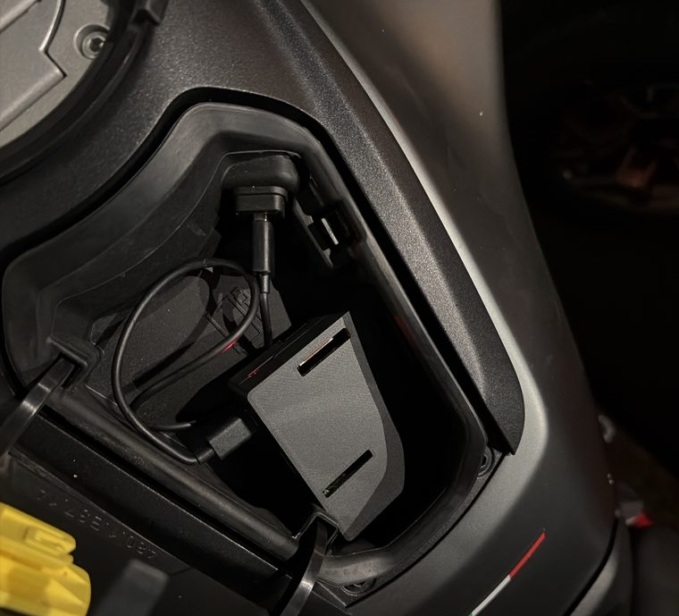

*The Pi in its printed case in the tank compartment, powered by the bike's USB socket there (top of the picture).*

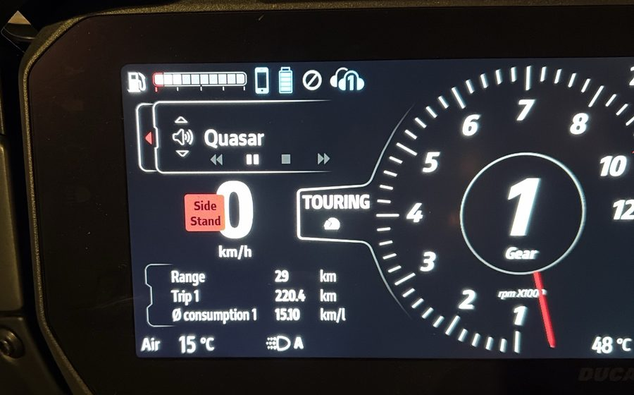

*The bike's own Music menu, outside Ducati Connect: the track title comes from CarPlay through the Pi.*

- 22 Oct 2026 — first code: the screen link against an emulated dashboard
- 24 Oct 2026 — first evening on the bike: the Pi's home screen on the real dashboard, joystick, cold start
- 26 Oct 2026 — the real Carlinkit on the bench: CarPlay at the dashboard's size, music and calls
- 10 Nov 2026 — calls handled from the helmet, the iPhone always on CarPlay, about 20 frames per second with music
- 14 Nov 2026 — installer and clean-up for this repository
- 16 Nov 2026 — first start of the ready-made card on a real Pi: two defects found and fixed, then pairing, CarPlay,
  phonebook and messages from scratch
- 16 Nov 2026, evening — on the bike with that card: pairing from scratch, CarPlay on the dashboard for a ride,
  music, a call; Back added to the joystick on the spot, and at home the logs showed why CarPlay had not come
  back by itself after a drop
- 17 Nov 2026 — on the bench: Siri hears the helmet and answers, and the eight movement commands of the dongle
  tried one by one, which gave the joystick its present moves
- 18 Nov 2026 — a leaner card image (fewer services, no graphics, the settings no longer rewritten at every
  start) and a line in `mtspi.txt` that switches Siri on
- 19–21 Nov 2026 — the card protected against power cuts: 300 real power cuts in a night on a test card, then
  built into the image, then 241 more on the card that went on the bike
- 21 Nov 2026 — second ride: the protected card, real battery and signal on the dashboard, Siri from the helmet
  made to work from the saddle by showing it to the bike as a call; three faults that needed the key, and at home
  the new tries and the restarts that should make the key unnecessary

## Repository layout

```
install.sh        installs MTS Pi on a Raspberry Pi OS that is already running
image/build.sh    builds the ready-to-flash card image (run by the GitHub workflow)
mtspi/            the program (Python)
  bridge.py         CarPlay ↔ dashboard: video, keys, audio routing, calls
  carlinkit*.py     Carlinkit dongle protocol and USB transport
  hfp_ag.py         the Pi as the bike's phone (hands-free gateway, call audio)
  avrcp_bridge.py   the bike's Music menu
  pbap.py, mns.py   phonebook and message services
  bluez.py          BlueZ, oFono and obexd over D-Bus
  session.py        Wi-Fi Direct to the dashboard and session start-up
  dashboard.py      the Pi's home screen
  tasks.py          keeps background tasks alive
myspin/           phone side of the dashboard's screen link, binary only, non-commercial use
system/           services, system configuration, helper scripts, the optional settings file
  update.py         installs an update copied to the card (and makes the update packages)
  sysfiles.sh       the files of ours outside the program folder, for install.sh and for an update
tests/            automatic tests of the open part
docs/             diagrams, screenshots and photos
```

## Credits and references

- [rhysmorgan134/node-CarPlay](https://github.com/rhysmorgan134/node-CarPlay) (MIT): the Carlinkit dongle
  protocol. `mtspi/carlinkit.py` and `mtspi/carlinkit_usb.py` are a Python port of its driver.
- [BlueZ](https://www.bluez.org/), [oFono](https://git.kernel.org/pub/scm/network/ofono/ofono.git),
  [PipeWire](https://pipewire.org/) and [PyAV](https://github.com/PyAV-Org/PyAV) do the heavy lifting on the Pi.
- Full list with licenses: [THIRD-PARTY.md](THIRD-PARTY.md).

Ducati, Multistrada, Ducati Connect, Apple, iPhone, CarPlay, Siri, mySPIN, Bosch, Carlinkit, AutoKit, Waze, Google
Maps and Raspberry Pi are trademarks of their respective owners, used here only to describe what the project
works with. The code contains no third-party logos or artwork. The photos show our own bike and parts: the
dashboard, the Pi, the dongle, and CarPlay with the apps and the icon that were on it that evening.

## At your own risk

This is a hobby project, not a product. It connects to the dashboard as a phone would, for interoperability with
equipment you own. Everything is provided **as is, without any warranty, at your own risk**. The authors are not
responsible for any damage, to the bike or otherwise.

## License

- **Everything you can read here** (the program, the installer, the system files) is under the MIT license:
  use it as you wish. See [LICENSE](LICENSE).
- **The binary files in `myspin/`** are for personal, non-commercial use only: on your own bike, for study, in a
  hobby project. They may not be sold or built into anything that is sold. See
  [myspin/LICENSE.txt](myspin/LICENSE.txt).
