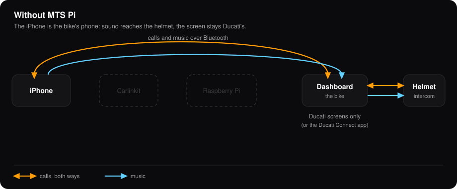
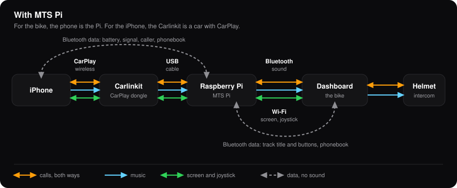
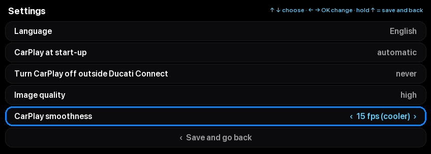

# MTS Pi — Apple CarPlay on the Ducati Multistrada V4 S dashboard

Apple CarPlay on the **original 6.5" dashboard** of the Ducati Multistrada V4 S, using a **Raspberry Pi 3 A+** and a
**Carlinkit CPC200-CCPA** dongle: about 110 € of parts at late-2026 prices, plus a microSD card. Nothing on the bike is modified and nothing is installed on
the iPhone. The Pi connects to the dashboard the way a phone running the Ducati Connect app does, and to the iPhone
it looks like a car with wireless CarPlay.

What you get on the bike:

- **CarPlay on the dashboard**, drawn at the dashboard's own size and driven with the handlebar joystick: Maps,
  Waze, Google Maps, music, podcasts, messages;
- **music and navigation voice in the helmet**, through the bike's own Bluetooth link to the intercom;
- **phone calls**: ring with the caller's name, answer and hang up from the bike or the helmet button, voice both ways;
- the bike's own **Music** and **Phone** menus keep working: track title and play/pause/skip, phonebook, recent calls;
- a small **home screen** of the Pi inside Ducati Connect: start and stop CarPlay, see what is connected, settings.


*The Pi's home screen, drawn by the code at 848×304: the area the dashboard gives to Ducati Connect.*

> **Status: beta.** Everything above works on the bench with the real Pi, the real dongle, a real iPhone and a
> helmet intercom. On the bike we have run the Pi's own screen, the joystick and a cold start (24 Oct 2026).
> The ready-made card has been started from scratch on a real Pi (16 Nov 2026): it reaches CarPlay and the home Wi-Fi
> by itself, and once the iPhone is paired the phonebook and the messages arrive. **CarPlay on the real dashboard and pairing with the bike from scratch are the
> next tests**; `install.sh` on a blank system has not been run on a real Pi yet. This page is updated as they
> happen.

> **Unofficial project, at your own risk.** MTS Pi is a hobby project, not a product. It is not affiliated with,
> endorsed by or supported by Ducati, Apple, Bosch, Carlinkit or Raspberry Pi. Set things up with the bike standing
> still, and ride with your eyes on the road: you are responsible for riding safely and for the traffic laws that
> apply to you.

## How it works

The dashboard talks to **one phone at a time**. Normally that phone is your iPhone: calls and music reach the
helmet through the bike, but the screen stays Ducati's (or shows the Ducati Connect app, which has its own
navigation and nothing else).



With MTS Pi, **the bike's phone is the Pi**. The iPhone is disconnected from the bike (the pairing can stay) and
talks to the Pi in two ways: CarPlay through the Carlinkit, and a plain Bluetooth link for data.



The devices sit in the same place in both pictures; only the arrows change.

| Path | Route |
|---|---|
| **Screen** | CarPlay video (H.264) → Carlinkit → USB → Pi: decoded, redrawn at 848×304, sent as JPEG frames over Wi-Fi to the dashboard. The joystick comes back the same way and becomes CarPlay key presses. |
| **Music** | CarPlay audio → USB → Pi → Bluetooth (A2DP) → dashboard → helmets. CarPlay's own sounds (navigation voice, alerts) are mixed into it. |
| **Calls** | CarPlay call audio → USB → Pi → Bluetooth (HFP) → dashboard → helmet, and the helmet microphone goes the other way to the iPhone. |
| **Bike data** | Bluetooth between Pi and dashboard: the control channel of the screen link, track title and buttons of the Music menu (AVRCP), phonebook and recent calls (PBAP). |
| **iPhone data** | Bluetooth between iPhone and Pi: battery, signal and the caller's number (HFP), phonebook (PBAP). No sound travels here: the Pi deliberately does not offer itself to the iPhone as a headset, so calls and music always stay on CarPlay. |

Two things make this possible on such a small board:

- The dashboard tells the phone how big its picture is (848×304 on the V4 S), and CarPlay is asked for exactly
  that size. Nothing is scaled, and there are no black bands.
- The Pi 3 A+ has one radio chip for Wi-Fi and Bluetooth, like a phone. It carries the Wi-Fi link to the dashboard
  and three Bluetooth links at once (dashboard, helmet side through the bike, iPhone). Most of the work in this
  project went into keeping that radio happy: see [Things we learned](#things-we-learned).

## Hardware

| Part | Notes |
|---|---|
| Raspberry Pi **3 Model A+** | The only board tested. Small, low power, hardware H.264 decoding, 2.4/5 GHz Wi-Fi and Bluetooth on one chip. Add a small heatsink. |
| Carlinkit **CPC200-CCPA** | The "wireless CarPlay for Android head units" dongle (it shows up as *AutoKit*). **Not** the "wired to wireless" adapters such as the 2air: those need a car that already has CarPlay. Ours: USB ID 1314:1520, firmware 2025.10.15. Do not update the firmware if it works. |
| microSD card | 8 GB is enough for space (the installed system takes about 3 GB). In practice: a 32 GB **Class 10** card (A1 if you can), from about 13 € for a budget brand to about 23 € for SanDisk or Samsung at late-2026 prices. Our bench tests ran on a SanDisk Ultra 32 GB (Class 10, A1). Avoid old Class 4 cards: we tried one, writing the image took about 20 minutes instead of 3. A "high endurance" card is not needed: the Pi writes very little. |
| 5 V power | Measured **0.54–0.89 A at 5 V** with the dongle. Use a supply that gives 2 A or more: a weak one causes under-voltage and random faults. |
| iPhone | Any iPhone with CarPlay. |

The Carlinkit plugs into the Pi's only USB port. That is all the wiring there is.

## Install

There are two ways. Both end with the same system on the card.

### The easy way: a ready-made card, no commands

You need a computer with an SD card reader (or a USB adapter for microSD cards).

1. **Download the card image**: the file `mts-pi-….img.xz` from the
   [Releases page](https://github.com/nostoi-labs/mts-pi/releases) of this repository.
2. **Install [Raspberry Pi Imager](https://www.raspberrypi.com/software/)**, the free program that writes cards
   (Windows, macOS, Linux).
3. **Write the card.** In Raspberry Pi Imager choose the device (*Raspberry Pi 3*), then as operating system pick
   **Use custom** and select the file you downloaded, then choose your microSD card and write it. If the program
   asks whether to apply customisation settings, answer **No**: nothing needs to be set. Writing takes a few
   minutes with a Class 10 card. The progress counter can go past 100 % (we saw 110 %): the program
   underestimates the size of the file. What counts is the verification that follows.
4. **Start the Pi.** Put the card in the Pi, plug the Carlinkit into its USB port and power it. The first start
   takes a few minutes: the Pi makes room on the card (its green light stays on while it does). When **MTS Pi**
   shows up among the Bluetooth devices on your iPhone, it is ready: go on with [Pairing](#pairing). The light on
   the Carlinkit stays red until CarPlay connects.

That is all. The Pi does not need your home Wi-Fi, a keyboard or a screen. To update, write a newer image the same
way and pair again.

**Optional: your country, home Wi-Fi and remote access.** After writing the card, take it out and put it back
in: your computer shows a small drive called `bootfs`. On it there is a text file, `mtspi.txt`. Open it with any
text editor and fill in what you want: the two-letter code of your country (recommended), the name and password
of your home Wi-Fi, and an SSH public key if you want to log in to the Pi from your computer
(`ssh mtspi@mts-pi.local`). The Pi applies the file at every start and removes the Wi-Fi password from it once it
has been used. With a home Wi-Fi set, and no bike around, the Pi joins it about a minute and a half after
power-on. Leave the file as it is if none of this means anything to you.

> The ready-made image is built automatically from this repository by
> [`image/build.sh`](image/build.sh): it is the official Raspberry Pi OS Lite with MTS Pi installed by the same
> `install.sh` described below.

### The manual way: for people who want to look inside

1. Write **Raspberry Pi OS Lite (64-bit)** to the SD card with Raspberry Pi Imager. In the Imager settings choose a
   user name and password, enter your home Wi-Fi **with its country**, and turn SSH on.
2. Put the card in the Pi, plug the Carlinkit in, power the Pi, wait two minutes and connect:
   `ssh <user>@<hostname>.local`
3. On the Pi:

   ```bash
   sudo apt-get update && sudo apt-get install -y git
   git clone https://github.com/nostoi-labs/mts-pi.git
   cd mts-pi
   ./install.sh
   sudo reboot
   ```

The installer sets up Bluetooth, Wi-Fi Direct, the audio services and the MTS Pi services. It does not touch the
boot files and it does not remove pairings. `./install.sh --help` lists the options (another Bluetooth name, a
setup without the Carlinkit). You can run it again at any time, for example after `git pull`.

**Where the Pi is on the network.** At every power-on the Pi first looks for the bike, and its Wi-Fi is busy doing
that. Without the bike it goes back to your home Wi-Fi after about a minute. So after a reboot at home, wait a
minute before you connect with SSH.

## Pairing

Once, with the bike standing still and the Pi powered:

1. **Bike ↔ Pi.** On the dashboard open the Bluetooth settings, pair a new smartphone and pick **MTS Pi**. The Pi
   accepts by itself.
2. **iPhone ↔ Pi.** On the iPhone: Settings › Bluetooth › **MTS Pi**, and confirm the code the iPhone shows (the
   Pi accepts by itself). Then tap the **(i)** next to MTS Pi and turn on **Sync Contacts** and **Show
   Notifications**: the bike's Phone menu and the caller's name use them. The two switches appear a few seconds
   after pairing; the phonebook reaches the Pi within a few minutes.
3. **iPhone ↔ Carlinkit.** In the same list pick the dongle (its name starts with **AutoKit**) and accept
   "Use CarPlay". It takes about ten seconds, once; after that CarPlay connects by itself, about ten seconds
   after the Pi has started.

If your iPhone was paired with the bike directly, **disconnect** it there (no need to delete the pairing): the
bike keeps one phone at a time, and now that phone is the Pi.

## Using it

1. Turn the key. The Pi boots with the bike and connects by itself: Ducati Connect was ready about 53 s after
   key-on in our test on the bike.
2. Open **Ducati Connect** on the dashboard: the Pi's home screen appears, and CarPlay starts by itself (you can
   turn that off in the settings).
3. In CarPlay the joystick moves the selection, the centre press selects, and the **MTS** icon among the apps
   brings you back to the Pi's home screen.
4. Calls ring on the dashboard with the caller's name; answer and hang up from the bike or from the helmet.
5. Leave Ducati Connect whenever you want: music and calls keep going.



The settings page, on the dashboard: language (English or Italian), CarPlay at start-up, turning CarPlay off when
you leave Ducati Connect, and picture quality (three steps: higher quality means slightly fewer frames).

## What works

| Function | State | How |
|---|---|---|
| CarPlay on the dashboard | bench | Carlinkit over USB → H.264 decoded on the Pi → JPEG frames over Wi-Fi |
| Joystick in CarPlay | bench | arrows, OK and back sent to the dongle as CarPlay keys |
| Music in the helmet | bench | CarPlay audio → A2DP |
| Incoming and outgoing calls | bench | the dongle's audio commands → HFP towards the bike, microphone back to CarPlay |
| Caller's name | bench | number from the iPhone's HFP link, name from the phonebook kept on the SD card |
| The bike's Music menu | bench | track title from the dongle → AVRCP; the bike's buttons → CarPlay play/pause/skip |
| Phonebook in the bike's Phone menu | bench | PBAP from the iPhone to the Pi, then from the Pi to the bike |
| Battery and signal on the home screen | bench | the iPhone's HFP indicators |
| The Pi's home screen in Ducati Connect, joystick | **bike** | tried on the Multistrada on 24 Oct 2026 |
| Text messages on the bike | not yet | |
| Siri from the bike's phone button | written, never tried | off by default (`HFP_VR=1`) |

"Bench" means: real Pi, real Carlinkit, real iPhone, a helmet intercom playing the part of the bike's Bluetooth,
an emulated dashboard for the screen link, Wi-Fi on 2.4 GHz as on the bike.

## Measured

| What | Value | Where |
|---|---|---|
| Key-on → Ducati Connect ready | about 53 s (Pi boot 28 s + Wi-Fi 16 s) | bike, 24 Oct 2026 |
| Frames the dashboard asks for | 6–13 per second | bike, 24 Oct 2026 |
| CarPlay with a moving map and music | 20–22 frames per second at high quality | bench, 10 Nov 2026 |
| The same during a call | 18–19 frames per second | bench, 10 Nov 2026 |
| Bridge start → CarPlay connected | 4.5–8 s | bench |
| The same on a freshly written card | 8.5–9 s | bench, 16 Nov 2026 |
| First start of a ready-made card: power-on → CarPlay | about 2 min (slow Class 4 card) | bench, 16 Nov 2026 |
| The same → home Wi-Fi and remote login | about 2.5 min | bench, 16 Nov 2026 |
| Ring with the caller's name | 0.7 s | bench, 10 Nov 2026 |
| Answer from the helmet → voice open | 0.15–0.2 s | bench |
| Music back after a call | 0.6 s | bench, 10 Nov 2026 |
| Power | 0.54–0.89 A at 5 V | bench |
| Temperature with a copper heatsink | 55 °C | bench |

## Things we learned

Notes for anyone building something similar. Each of these cost an evening or more.

- **One radio, four links.** Wi-Fi to the dashboard is on 2.4 GHz, the same band as Bluetooth, on the same chip.
  It holds as long as Bluetooth stays light. What made the difference: idle Bluetooth links go to low-power mode
  after 2 s instead of 45 s; the Pi takes the "central" role on every link, so the radio serves one schedule
  instead of two; and no audio ever comes from the iPhone over Bluetooth.
- **Call audio must be paced by the radio.** Sending one voice packet for each packet received works. Sending
  them on a fixed clock put the Bluetooth chip into a hardware error within seconds.
- **The iPhone picks its audio output by itself.** If the Pi also offers itself as a headset, the iPhone
  sometimes sends the sound there instead of to CarPlay, and CarPlay goes silent. The Pi therefore presents to
  the iPhone only the data profiles.
- **The phone role towards the bike is our own.** The Linux telephony service (oFono) offers the "I am a phone"
  side of hands-free only with a real SIM, so the Pi has its own small hands-free gateway that mirrors the
  iPhone's real state.
- **Without a phonebook service the bike's Phone button stays grey**, and without a music player registered on
  the bike's link the Music menu shows nothing. Both are served by the Pi with data taken from the iPhone.
- **Wi-Fi Direct needs its own `wpa_supplicant`.** NetworkManager adopted the freshly formed group and tore it
  down. While the Pi is in bike mode, NetworkManager does not touch the Wi-Fi interface at all.
- **CarPlay sends video only when the picture changes.** A decoder that waits for the next frame before giving
  you the current one leaves the dashboard several screens behind. The decoder runs without frame threads and
  without a parser delay.
- **The dongle reports calls through audio commands**, not through a call-status message, and it must be told
  that it is not in "HiCar" mode or the iPhone never sees it.
- **A fresh Raspberry Pi OS keeps Wi-Fi off twice.** Unblocking the radio is not enough: NetworkManager also
  remembers Wi-Fi as switched off until a country is chosen. The home network was saved and never joined until
  the Pi turned Wi-Fi on there too.
- **The first start of a card can be rough.** On one card the Pi restarted abruptly twice during its first start (on another it did not). A settings
  line written a few seconds earlier came back as zero bytes, the system then ignored the whole settings file, and
  the bridge started without the dongle (red light, no CarPlay). Settings are now written aside, swapped in and
  flushed to the card.
- **A card you cannot reach can still tell you what happened.** The small `bootfs` partition is readable from any
  computer: a script started from `cmdline.txt` copied the logs there, and that is how the two problems above
  were found without a screen, a keyboard or a network.

## Settings

Most settings are on the dashboard. The rest live in `/etc/default/mtspi` (one `NAME=value` per line); after a
change: `sudo systemctl restart mtspi-bridge mtspi-hfp`.

| Setting | Meaning |
|---|---|
| `BT_NAME` | Bluetooth name of the Pi; change it with `sudo system/names.sh "New name"` |
| `CARLINKIT` | `usb` with the dongle, `none` without (Bluetooth bridge only) |
| `HOME_SSID` | your home Wi-Fi: the Pi returns to it when the bike is not there |
| `BIKE_ADDR` | Bluetooth address of the bike, if its Bluetooth name does not start with `DUCATI` |
| `BIKE_GRACE` | seconds without the bike before returning to the home Wi-Fi (default 45) |
| `HFP_VR` | `1` turns on Siri from the bike's phone button (experimental) |

The icon inside CarPlay is a plain red square with the letter M, labelled MTS. To use your own picture, save it as
`/var/lib/mtspi/oem_icon.png` (256×256 PNG).

Logs: `journalctl -u mtspi-bridge -u mtspi-hfp -u mtspi-wifi-mode`, plus one folder per run in `/var/lib/mtspi/`
(the last 20 are kept).

## Known limits

- All the iPhone's sound goes through CarPlay: if CarPlay stops, there is no music and there are no calls until
  it is back.
- After a Bluetooth radio error the Pi needs a restart and the dongle must be powered again: on the bike, key off
  and on.
- Once, music stuttered for about a minute after an incoming call.
- The SD card is not protected against the bike cutting the power. Keep a copy of the card once it works.
- The files in `myspin/` are binary and built for Raspberry Pi OS 64-bit with Python 3.13 only.
- Tested with one bike, one iPhone and one dongle.
- The "pro" variant mentioned in the code (a second, external Bluetooth radio) is not part of this release.

## Roadmap

What is planned for the next releases, roughly in this order.

| | What | Why |
|---|---|---|
| 1 | **Confirmed on the bike**: CarPlay on the real dashboard, pairing from scratch, the ready-made card | everything below builds on this |
| 2 | **Status light**: the Pi's LED tells you when it is ready to pair and when something is wrong | the ready-made card has no screen to look at |
| 3 | **SD card protection**: a read-only system | the bike cuts the power without warning |
| 4 | **Leaner system**: everything the Pi does not need is turned off | faster start, less power, less heat |
| 5 | **Siri** from a long press of the joystick, with the helmet microphone | hands stay on the bars |
| 6 | **Updates** without writing the card again | no new pairing at every update |
| 7 | **Automatic recovery** after a Bluetooth radio error | today it takes key off and on |
| 8 | Text messages in the bike's menu, the name under the CarPlay icon, finer joystick moves in the app grid | details |

Later: the "pro" variant with a second radio, and tyre pressure and temperature from Bluetooth valve sensors on
the home screen.

## Our build

Photos of the installation on the bike and the build log will be added here.

- 22 Oct 2026 — first code: the screen link against an emulated dashboard
- 24 Oct 2026 — first evening on the bike: the Pi's home screen on the real dashboard, joystick, cold start
- 26 Oct 2026 — the real Carlinkit on the bench: CarPlay at the dashboard's size, music and calls
- 10 Nov 2026 — calls handled from the helmet, the iPhone always on CarPlay, about 20 frames per second with music
- 14 Nov 2026 — installer and clean-up for this repository
- 16 Nov 2026 — first start of the ready-made card on a real Pi: two defects found and fixed, then pairing, CarPlay,
  phonebook and messages from scratch

## Repository layout

```
install.sh        installer
image/build.sh    builds the ready-to-flash card image (run by the GitHub workflow)
mtspi/            the program (Python)
  bridge.py         CarPlay ↔ dashboard: video, keys, audio routing, calls
  carlinkit*.py     Carlinkit dongle protocol and USB transport
  hfp_ag.py         the Pi as the bike's phone (hands-free gateway, call audio)
  avrcp_bridge.py   the bike's Music menu
  pbap.py, mns.py   phonebook and message services
  bluez.py          BlueZ, oFono and obexd over D-Bus
  session.py        Wi-Fi Direct to the dashboard and session start-up
  dashboard.py      the Pi's home screen
myspin/           phone side of the dashboard's screen link, binary only, non-commercial use
system/           services, system configuration, helper scripts, the optional settings file
tests/            automatic tests of the open part
docs/             pictures
```

## Credits and references

- [rhysmorgan134/node-CarPlay](https://github.com/rhysmorgan134/node-CarPlay) (MIT): the Carlinkit dongle
  protocol. `mtspi/carlinkit.py` and `mtspi/carlinkit_usb.py` are a Python port of its driver.
- [BlueZ](https://www.bluez.org/), [oFono](https://git.kernel.org/pub/scm/network/ofono/ofono.git),
  [PipeWire](https://pipewire.org/) and [PyAV](https://github.com/PyAV-Org/PyAV) do the heavy lifting on the Pi.
- Full list with licenses: [THIRD-PARTY.md](THIRD-PARTY.md).

Ducati, Multistrada, Ducati Connect, Apple, iPhone, CarPlay, Siri, mySPIN, Bosch, Carlinkit, AutoKit, Waze, Google
Maps and Raspberry Pi are trademarks of their respective owners, used here only to describe what the project
works with. The repository contains no third-party logos or artwork.

## At your own risk

This is a hobby project, not a product. It connects to the dashboard as a phone would, for interoperability with
equipment you own. Everything is provided **as is, without any warranty, at your own risk**. The authors are not
responsible for any damage, to the bike or otherwise.

## License

- **Everything you can read here** (the program, the installer, the system files) is under the MIT license:
  use it as you wish. See [LICENSE](LICENSE).
- **The binary files in `myspin/`** are for personal, non-commercial use only: on your own bike, for study, in a
  hobby project. They may not be sold or built into anything that is sold. See
  [myspin/LICENSE.txt](myspin/LICENSE.txt).
